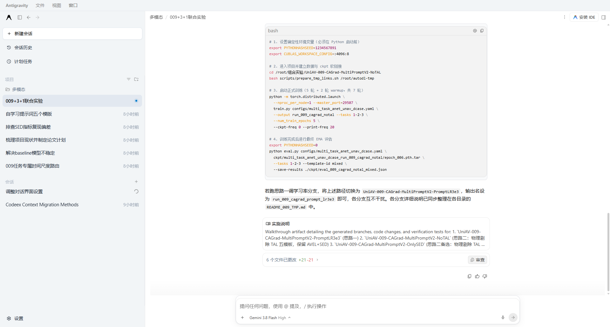

# Antigravity Codex Theme (1:1 像素级复刻 OpenAI Codex 桌面端质感)

> **支持系统**：Windows / macOS / Linux（内置全平台一键部署与双击还原脚本）
>
> **适用版本**：Antigravity 2.x 全系列（Electron 架构桌面端）
>
> **设计目标**：将 Antigravity 官方扁平、发灰、刺眼且横向过度拉伸的界面，**1:1 精准重构为 OpenAI Codex 桌面端**的经典灰白空间层次、深墨纯净字体、无边框数据胶囊与黄金视宽排版。
>
> **安全承诺**：自动备份官方核心 `app.asar`，一键安装与秒级无损还原，绝不修改核心编译二进制。

---

## 📸 效果展示 (Before & After)



---

## ✨ 核心解决痛点与重构特色

### 1. 经典冷暖双区层次（告别整屏惨白与刺眼）
* **侧边栏与菜单顶栏**：全面重构为 Codex 标志性的浅雅冰灰蓝（`#F2F5F7`），并在右侧注入细致的浅灰空间分界线（`#E5E7EB`）。
* **会话列表胶囊**：当前选中会话采用 Codex 同款柔灰微圆角卡片（`#E2E8F0`），低反差、护眼、聚焦。

### 2. 深墨字色与 Windows 次像素 ClearType 渲染（告别发灰模糊）
* **纯正深墨黑字**：正文字色从原版发灰泛蓝的 `#1e293b` 全面替换为 Codex 官方深墨色 `#0d0d0d`。反差充沛，汉字笔画清晰扎实。
* **原生次像素平滑**：保留 Windows 系统的 ClearType 次像素渲染机制，消除了原版强制灰度抗锯齿导致的字体笔画发细、发毛等疲劳感。
* **黄金排版比例**：对齐 Codex 桌面端基准，正文采用 `15px` 字号配合 `25px` 行高（1.68x），字距紧凑精致。

### 3. 无边框行内数据微胶囊（Token Badges）
* **去硬框化**：消除了原版带有粗糙 `1px` 灰框的代码标签，改用 Codex 原汁原味的浅灰圆角底色（`rgba(0, 0, 0, 0.05)`）。
* **视觉节奏**：数字、参数、指标自然内嵌在文本流中，形成醒目却温润的视觉锚点。

### 4. 720px 黄金阅读视宽约束（告别横向大漠与简陋感）
* 将中心阅读柱严格约束在 `720px` 黄金视宽（单行容纳约 38 个汉字）。
* 消除原本在 1080p/2K/4K 屏幕上横跨一整屏的稀疏草稿感，阅读目光跳行轻松自然。

### 5. 取消上滑历史记录时的提问吸顶遮挡
* 原版在向上回看历史对话时，会将上一条用户提问强制吸顶悬浮并带有下向黑色遮罩，挡住历史内容。
* 本补丁将提问框重构为自然流式排版（`position: static`），跟随滚动自然划走，视野彻底通透。

---

## 🚀 极速安装与使用指南

### Windows 用户（推荐）
1. 下载或克隆本仓库到本地。
2. 退出正在运行的 Antigravity 软件。
3. 双击运行 **`双击安装Codex主题.bat`**。
4. 提示 `[√] 成功！` 后，重新打开 Antigravity 即可。

### macOS / Linux 用户
打开终端，进入本仓库目录运行：
```bash
chmod +x install.sh uninstall.sh
./install.sh
```

---

## 🔄 卸载与恢复官方原版

如果你需要恢复官方原版样式：
* **Windows**：双击运行 **`双击恢复原版主题.bat`** 即可瞬间还原。
* **macOS / Linux**：终端运行 `./uninstall.sh`。

---

## 📂 项目文件结构

```
antigravity-codex-theme/
├── 双击安装Codex主题.bat    # Windows 双击一键安装入口
├── 双击恢复原版主题.bat    # Windows 双击一键卸载还原入口
├── install.sh             # macOS / Linux 终端安装脚本
├── uninstall.sh           # macOS / Linux 终端还原脚本
├── patch_theme.py         # 跨平台解包注入与安全封装引擎
├── codex_theme.css        # 1:1 Codex 像素级重构样式表
├── showimg/               # 效果展示截图
│   └── preview.png
├── LICENSE                # MIT 开源协议
└── README.md              # 项目中文说明文档
```

---

## 🛠️ 技术原理与安全保障

1. **零二进制入侵**：不修改任何底层二进制执行文件，仅通过标准工具 `@electron/asar` 解包 `app.asar`。
2. **Preload 样式注入**：在 Electron 的前端加载生命周期入口 `preload.js` 中安全挂载样式，与业务逻辑完全解耦。
3. **独立备份容灾**：首次运行自动将官方原版备份为 `app.asar.before_codex_patch.bak`，随时可以 100% 无损复原。
