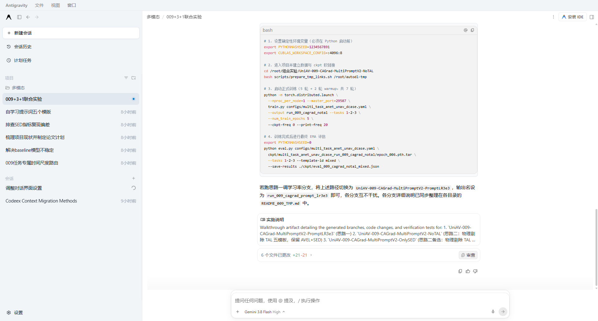

# Antigravity Codex Theme (1:1 复刻 OpenAI Codex 桌面端质感)

> 支持系统：Windows / macOS / Linux（零依赖纯 Node.js 原地无损封包，内置一键安装与还原脚本）
>
> 适用版本：Antigravity 2.x 全系列（已专门适配 v2.34.0+ `app.asar.unpacked` 原生依赖拆分架构）
>
> 设计目标：直接对齐本地 OpenAI Codex 桌面端的设计规范，将 Antigravity 界面重构为无缝全屏白底画布、冰白侧边栏、720px 严格对齐阅读柱、15px/1.66 ClearType 深墨字体与单层 22px 精致输入框。
>
> 安全承诺：纯 Node.js 原地修补 Chromium Pickle ASAR 索引，完整保留全部 `unpacked` 原生二进制依赖，写入前执行 `vm.Script` 语法校验，并自动备份支持秒级无损还原。

---

## 效果展示



---

## 核心特性（v4.2 Light & Dark 双色镜像）

1. 浅色 / 深色 / 跟随系统实时无缝切换与切号自愈
- 所有颜色全面变量化（`--codex-*`），内置轻量级 `MutationObserver`、系统主题监听与 `<head>` 样式置底守护，切换浅色/深色/跟随系统或切换账号时毫秒级同步，并自动联动 Windows 原生右上角窗口控制按钮底色（`titleBarOverlay`），杜绝黑块、白块错乱与样式丢失。
- 浅色模式还原 OpenAI Codex Light（薄荷云母顶栏、冰白侧边栏 `#F7FAFA`、纯白无缝画布 `#FFFFFF`、深墨字 `#0D0D0D`）。
- 深色模式还原 OpenAI Codex Dark（`#212121` 深灰主画布、`#181818` 哑光侧边栏与顶栏、`#2A2A2A` 单层输入框、`#171717` 代码块、`#ECECEC` 柔白字）。

2. 全屏无缝画布与 720px 严格对齐
- 移除对话区外圈 8px 留白与 12px 卡片圆角，还原 Codex 桌面端的通透白底画布。
- 主对话流与底部输入框严格对齐至 `720px` 黄金阅读视宽，消除左右错位。
- 底部输入框重构为单层 22px 圆角、96px 高度与极细浅灰边框。

2. 深墨字体与 Windows ClearType 次像素渲染
- 正文统一采用 `15px / 1.66` 行高、400 标准字重、`#0D0D0D` 深墨色。
- 开启 `subpixel-antialiased` 次像素渲染，告别原版发灰、笔画发虚的视觉疲劳。
- 取消上滑历史记录时的用户提问吸顶遮挡，让长对话回溯视野彻底通透。

3. 冰白净化侧边栏
- 侧边栏采用 `#F7FAFA` 冰白背景、纯色吸顶分组标题与 3.5px 极细滚动条。
- 会话时间戳默认隐藏，鼠标悬停时平滑显示，界面干净克制。

4. 零依赖原地无损 ASAR 引擎（支持 v2.34.0+）
- 摒弃会破坏 `app.asar.unpacked` 标记的传统全量解包重封，直接用内置 Node.js 原地修补 `dist/preload.js`。
- 完整保留官方全部 377+ 个 `unpacked` 原生依赖，不依赖 Python，也不需要联网下载 `@electron/asar`。

5. 运行时自动更新（下载一次，永久免重复下载）
- 无论通过 `git clone` 还是网页下载 ZIP，每次双击安装脚本时都会自动联网检查 `qiuyizipi/antigravity-codex-theme` 的最新 `patch_theme.js` 和 `codex_theme.css`（自动兼容 Windows 系统代理，无需 Git）。
- 若检测到新版脚本，会先通过 `vm.Script` 语法校验再替换，并自动无缝切换至新版继续执行；若处于离线或无法访问 GitHub 状态，自动降级使用本地文件完成安装（也支持加 `--no-update` 跳过联网检查）。

6. 一键联动最新中文汉化
- 内置 `--with-cn` 一键联动模式：自动拉取或更新开源汉化仓库 [Silas-02/antigravity-desktop-cn](https://github.com/Silas-02/antigravity-desktop-cn) 并执行汉化，随后无损叠加注入本仓库的 Codex v4.2 主题。
- 客户端升级后只需双击一次即可同时完成“最新中文汉化 + Codex 主题”全套部署。

---

## 快速安装指南

环境要求：已安装 Node.js（推荐 Node 18+）。无需安装 Python，也不强制要求安装 Git（未装 Git 时自动改用 ZIP 下载并自动兼容 Windows 系统代理）。

### Windows 用户（推荐）
1. 下载或克隆本仓库到本地。
2. 按需选择以下脚本双击运行（脚本会自动识别常见安装路径并关闭残留客户端进程）：
   - 仅安装 Codex 主题：双击 `双击安装Codex主题.bat`
   - 一键同步最新中文汉化 + 安装 Codex 主题：双击 `双击一键汉化并安装Codex主题.bat`
   - 若安装在非默认目录未能自动识别：直接将 Antigravity 安装目录或 `Antigravity.exe` 拖拽到 `.bat` 脚本图标上即可；若装在 `C:\Program Files`，请右键「以管理员身份运行」。
3. 提示 `[OK] 成功` 后，重新打开 Antigravity 即可。

### macOS / Linux 用户
```bash
chmod +x install.sh uninstall.sh

# 仅安装 Codex 主题
./install.sh

# 一键联动最新中文汉化 + Codex 主题
./install.sh --with-cn
```

### 常用命令行参数
```bash
# 只读检测当前 app.asar 版本、语法及补丁状态
node patch_theme.js --check

# 联动汉化并叠加主题（可选 --no-kill 不关闭客户端，--no-update 跳过联网检查）
node patch_theme.js --with-cn --no-kill --no-update

# 仅安装主题
node patch_theme.js

# 恢复原版主题
node patch_theme.js --uninstall
```

---

## 卸载与还原

- Windows：双击 `双击恢复原版主题.bat`
- macOS / Linux：终端运行 `./uninstall.sh`

脚本会优先从 `app.asar.before_codex_patch.bak` 无损还原；若备份不存在，也会原地干净剥离 Codex 主题代码块，不会损坏原有程序或汉化内容。

---

## 项目文件结构

```text
antigravity-codex-theme/
├── 双击一键汉化并安装Codex主题.bat  # Windows 一键联动汉化 + Codex 主题
├── 双击安装Codex主题.bat            # Windows 双击仅安装 Codex 主题
├── 双击恢复原版主题.bat             # Windows 双击一键还原
├── install.sh                       # macOS / Linux 安装入口（支持 --with-cn）
├── uninstall.sh                     # macOS / Linux 还原入口
├── patch_theme.js                   # 零依赖 Node.js 原地无损 ASAR 注入与校验引擎
├── codex_theme.css                  # v4.2 Light & Dark 双色 Codex 样式表
├── showimg/preview.png              # 实机效果截图
├── LICENSE                          # MIT 开源协议
└── README.md                        # 说明文档
```

---

## 致谢与声明

- 中文汉化能力通过一键脚本在线联动 [Silas-02/antigravity-desktop-cn](https://github.com/Silas-02/antigravity-desktop-cn) 实现，本仓库不直接分发第三方汉化源码，版权归原作者所有。
- 本仓库内的 Codex 视觉主题样式表（`codex_theme.css`）与原地无损 ASAR 注入引擎（`patch_theme.js`）采用 MIT 协议开源。
